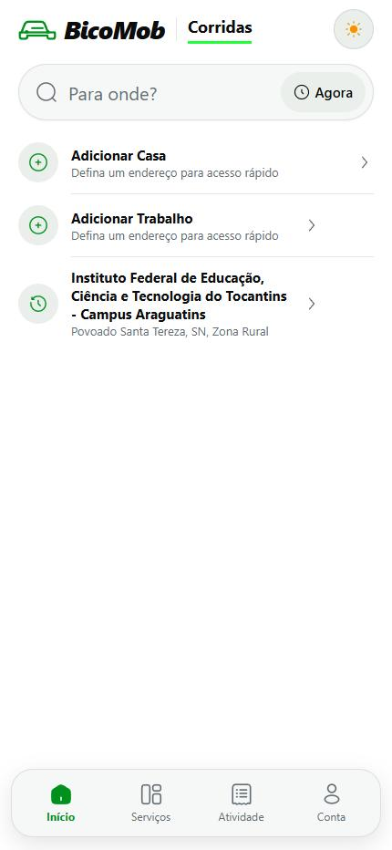
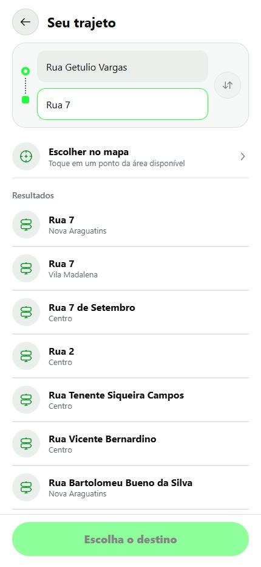
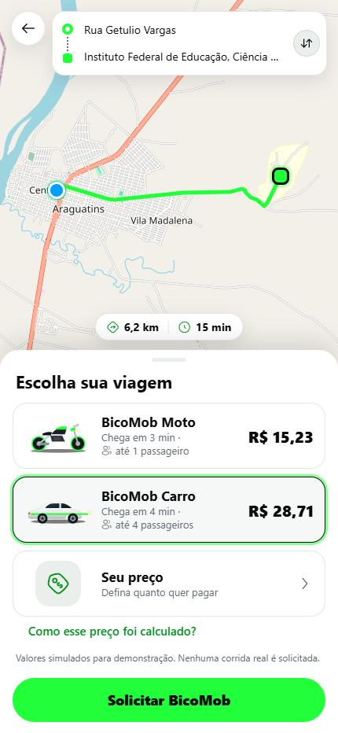
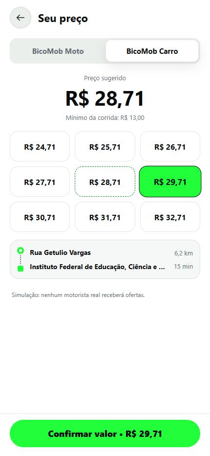
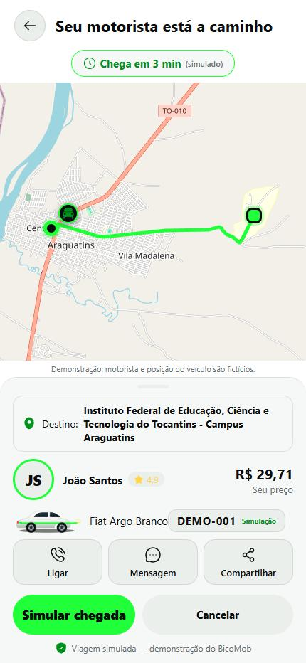

# BicoMob

### Sua próxima viagem começa aqui.

Uma nova forma de explorar a mobilidade urbana. Escolha seu destino, descubra as melhores opções de viagem e acompanhe cada etapa em uma experiência simples, moderna e intuitiva.

**BicoMob é um protótipo interativo de um aplicativo de transporte**, desenvolvido para demonstrar como uma plataforma de mobilidade pode conectar pessoas, destinos e possibilidades por meio da tecnologia.

> **É uma demonstração.** Não há motoristas, pagamentos, cadastro ou corridas reais. Motorista, veículo, placa, avaliação, previsão de chegada e valores são fictícios e identificados como simulação. Mapas e endereços, porém, são reais.

<p align="center">
  
  
  
  
  
  
</p>

## A experiência

**Entrar → Para onde? → Escolher o destino → Confirmar a partida → Ver o mapa e os preços → Escolher Moto, Carro ou Seu preço → Solicitar → Acompanhar o motorista simulado → Recibo e histórico.**

- **Início simples:** marca, campo “Para onde?”, favoritos (Casa e Trabalho, definidos por você) e destinos recentes.
- **Pesquisa de endereços** de ruas, bairros, escolas, hospitais, comércios e pontos de interesse, com sugestões enquanto você digita.
- **Partida pela sua localização** (com permissão), por endereço ou tocando no mapa.
- **Rota no mapa** com distância, duração e preços calculados.
- **Escolha da viagem só depois da rota:** *BicoMob Moto*, *BicoMob Carro* ou *Seu preço*, uma tela em que você escolhe um valor entre opções próximas ao sugerido.
- **Corrida simulada completa:** procurando motorista → motorista aceita → viagem em andamento → conclusão → recibo, avaliação e histórico.
- **Tema claro por padrão** (com opção de modo escuro pelo botão sol/lua no cabeçalho), verde `#7FFF00`, cartões arredondados e animações discretas.
- **Responsivo:** no computador aparece dentro de um celular virtual; no celular real ocupa a tela inteira.

## Área da demonstração

As corridas funcionam **exclusivamente dentro do município de Araguatins (TO)**. Origem, destino, pontos escolhidos no mapa, resultados de busca e a localização do GPS são validados pelas coordenadas contra o limite real do município. Locais de outras cidades nunca são aceitos. Se a pessoa estiver fora da área, o app informa e permite escolher a partida no mapa.

## Como executar

```bash
npm install
npm run dev        # http://localhost:5173
npm run build      # verificação de tipos + build de produção
npm test           # testes automatizados
```

Não há chaves de API. A localização exige HTTPS ou `localhost` e a permissão do navegador.

## Tecnologias

React · TypeScript · Vite · Leaflet · Iconify · Vitest.

Detalhes de funcionamento (busca, dados geográficos, serviços públicos, privacidade e limitações) estão em [`docs/TECNICO.md`](docs/TECNICO.md).

## Simulações

- Motoristas (nome, veículo, placa `DEMO-001`/`DEMO-002`), avaliação, previsão de chegada e movimento do veículo são fictícios.
- Ligar, mensagem e compartilhar têm comportamento simulado.
- Pagamento (Dinheiro, Pix, Cartão) é apenas visual; nada é cobrado.
- Tarifa: `max(mínima, base + km × valor/km + min × valor/min)`. Moto: 3,00 + 1,60/km + 0,15/min, mínima 7,00. Carro: 5,00 + 3,20/km + 0,25/min, mínima 13,00. Em “Seu preço” os valores alternativos seguem uma regra fixa (passos de R$ 0,50 até R$ 25 e R$ 1,00 acima, sempre incluindo o sugerido e nunca abaixo do mínimo). O valor escolhido é o mesmo no pedido, na tela do motorista e no recibo.

## Créditos

Mapas e dados © [contribuidores do OpenStreetMap](https://www.openstreetmap.org/copyright) (ODbL). Ícones: Solar (480 Design, [CC BY 4.0](https://creativecommons.org/licenses/by/4.0/)) e Phosphor (MIT).
