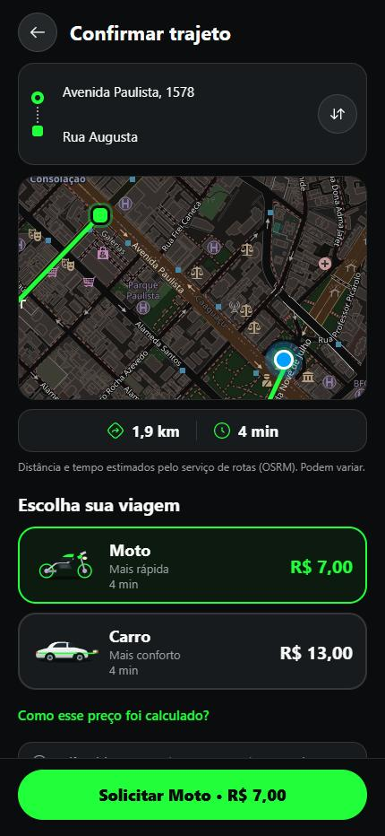
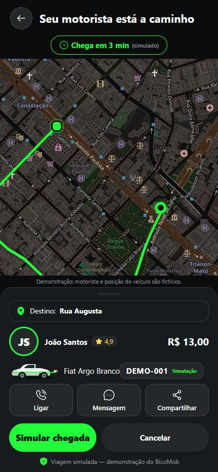

# BicoMob

### Sua próxima viagem começa aqui.

Uma nova forma de explorar a mobilidade urbana. Escolha seu destino, descubra as melhores opções de viagem e acompanhe cada etapa em uma experiência simples, moderna e intuitiva.

**BicoMob é um protótipo interativo de um aplicativo de transporte**, desenvolvido para demonstrar como uma plataforma de mobilidade pode conectar pessoas, destinos e possibilidades por meio da tecnologia.

> ⚠️ **É uma demonstração.** Não há motoristas, pagamentos, cadastro ou corridas reais. Motorista, veículo, placa, avaliação e previsão de chegada são fictícios e identificados como simulação. Mapas, ruas e endereços, porém, são dados reais do OpenStreetMap.

<p align="center">
  
  
  
  
  
</p>

## Principais funcionalidades

- **Entrar como Cliente** em um toque, sem cadastro.
- **Busca de destinos em qualquer cidade:** ruas, avenidas, bairros, estabelecimentos e endereços completos, com sugestões enquanto você digita, nome em destaque, endereço secundário e ícone por categoria.
- **Sua localização atual** (com a sua permissão) ou escolha manual da partida pesquisando ou tocando no mapa. A busca prioriza o que está perto de você, sem impedir outras cidades.
- **Mapa real** (OpenStreetMap) com sua posição, origem, destino e rota viária.
- **Comparação de preços** entre Moto e Carro, com o cálculo detalhado de cada tarifa.
- **Corrida simulada de ponta a ponta:** procurando motorista → motorista aceita → acompanhamento da viagem → finalização → recibo e avaliação.
- **Atividade** (histórico, detalhes e “repetir viagem”), **favoritos** e **recentes**, **conta** com pagamento demonstrativo, notificações, segurança, ajuda e tema claro/escuro.
- **Visual de app de mobilidade:** modo escuro, verde `#7FFF00`, ícones Iconify, cartões arredondados, animações discretas e navegação inferior.

## Tecnologias

React 18 · TypeScript · Vite · Leaflet / React Leaflet · Iconify (`iconify-icon`) · CSS próprio · Vitest

| Serviço (OpenStreetMap) | Papel |
|---|---|
| **Photon** | **Único** serviço do autocomplete (consultado enquanto você digita) |
| **Nominatim** (público) | Apenas em ações **explícitas e pontuais**: botão “Buscar no OpenStreetMap”/Enter e nome da rua do GPS ou de um ponto tocado no mapa. **Nunca** no autocomplete |
| **OSRM** | Rotas, distância e duração |
| **Tiles OSM** | Mapa |

## Como executar

```bash
npm install
npm run dev        # http://localhost:5173
npm run build      # typecheck + build de produção em dist/
npm run preview    # serve o build
npm test           # testes automatizados
npm run icons      # (opcional) baixa de novo os dados dos ícones usados
```

Não há chaves de API nem configuração geográfica: o app funciona em qualquer lugar do mundo. A localização exige HTTPS ou `localhost` e a permissão do navegador.

## Como a busca funciona

**Autocomplete (automático):**

1. Ao digitar (mínimo de 2 letras, *debounce* de 350 ms), a requisição anterior é cancelada e o **Photon** responde com sugestões, usando sua posição apenas como viés de proximidade (outras cidades continuam acessíveis).
2. Resultados são ordenados por relevância do texto e proximidade, sem duplicatas, paginados (8 por vez) e guardados em cache por 10 minutos. Falhas não ficam em cache.
3. Timeout de 4,5 s: se o Photon falhar, retornar erro (ex.: 429/503) ou demorar demais, a tela avisa e oferece **Tentar novamente**, **Buscar no OpenStreetMap** e **Escolher no mapa**. **Não há fallback automático** para outro serviço.
4. O endereço do Photon pode ser trocado por uma instância própria com a variável `VITE_PHOTON_URL` (ex.: `VITE_PHOTON_URL=https://meu-photon.exemplo/api/`), indicada para uso intenso.

**Busca explícita (só por ação do usuário):** o botão **Buscar no OpenStreetMap** (ou Enter) faz uma única consulta ao Nominatim público, em conformidade com a [política de uso](https://operations.osmfoundation.org/policies/nominatim/): nunca a cada tecla, mínimo de 3 letras, limite global de 1 requisição por segundo (compartilhado com a geocodificação reversa), cache de 30 minutos, sem repetir consulta igual em andamento e sem restringir a região (a posição só dá preferência). O navegador identifica o app pelo cabeçalho `Referer` (navegadores não permitem definir `User-Agent`).

**Sempre disponível:** **Escolher no mapa** aceita qualquer ponto, mesmo sem nenhum serviço de busca.

Alternativas avaliadas: Geoapify e LocationIQ têm bom autocomplete, mas exigem chave que ficaria exposta no navegador; o Overpass não faz busca de endereços e é instável para consultas interativas, por isso foi removido.

## Simulações e tarifas

- Motorista, placa (`DEMO-001`/`DEMO-002`), foto (iniciais), avaliação, previsão de chegada e movimento do veículo no mapa são **fictícios**.
- Ligar, mensagem e compartilhar têm comportamento simulado; nada é enviado por SMS, WhatsApp ou telefone.
- Pagamento (Dinheiro, Pix, Cartão) é apenas visual; nada é cobrado.
- Tarifa: `max(mínima, base + km × R$/km + min × R$/min)`. Moto: 3,00 + 1,60/km + 0,15/min, mínima 7,00. Carro: 5,00 + 3,20/km + 0,25/min, mínima 13,00. Valores de demonstração, sem taxas regionais, centralizados em `src/lib/fare.ts`.
- O preço mostrado na escolha é o mesmo do pedido, do motorista e do recibo.

## Privacidade

A posição real fica apenas na memória do navegador. Ela só sai do navegador de duas formas: (1) como viés de proximidade no autocomplete do Photon, **arredondada a ~1 km**; (2) na geocodificação reversa (nome da rua), feita no Nominatim. No histórico local é salva apenas uma posição aproximada (~100 m), sem o nome da rua. Dados da demo (histórico, favoritos, recentes) ficam no `localStorage` e podem ser apagados em **Conta → Limpar dados**.

## Responsividade

- **Desktop:** o app aparece dentro de um celular virtual centralizado (tela lógica de 430 × 900), ampliado ou reduzido de forma uniforme para caber na janela, com rolagem interna e sem barras visíveis.
- **Celular (≤ 600 px):** sem moldura, em tela cheia (`100dvh`, safe areas).
- Verificado em 1920×1080, 1440×900, 1366×768 e larguras de 320 a 430 px.

## Limitações das APIs públicas

- Photon, Nominatim, OSRM e os tiles do OSM são serviços públicos gratuitos, **sem garantia de disponibilidade** e com limites de uso. Em uso intenso, considere um provedor próprio ou pago.
- A cobertura depende da qualidade dos dados do OpenStreetMap em cada região; endereços recentes ou estabelecimentos sem cadastro podem não aparecer (use **Escolher no mapa**).
- Buscas por categoria genérica (ex.: “farmácia”) dependem de o local ter nome ou tipo cadastrado no OSM.
- Se o OSRM estiver indisponível, a rota vira uma linha tracejada e a distância é uma estimativa em linha reta (×1,3), com aviso na tela.
- A duração usa o perfil de carro do OSRM também para moto.
- O Nominatim público não pode ser usado para autocomplete; por isso só atende buscas explícitas e a geocodificação reversa, com limite global de 1 requisição por segundo.
- O Photon público também é de uso justo (sem garantia). Para uso intenso, hospede o seu e aponte `VITE_PHOTON_URL` para ele.

## Estrutura

```
src/
  App.tsx, store.tsx          navegação, estado e simulação da corrida
  screens/                    Tabs.tsx (início, serviços, atividade, conta) · Flow.tsx (busca, rota, corrida, recibo)
  components/                 Map, Icon (Iconify), ilustrações, UI
  lib/                        search · geo · routing · fare · places · net (+ testes)
  icons/                      mapa de ícones e dados empacotados (npm run icons)
```

## Créditos

Mapas e dados © [contribuidores do OpenStreetMap](https://www.openstreetmap.org/copyright) (ODbL). Ícones: Solar (480 Design, [CC BY 4.0](https://creativecommons.org/licenses/by/4.0/)) e Phosphor (MIT), via [Iconify](https://iconify.design/).
